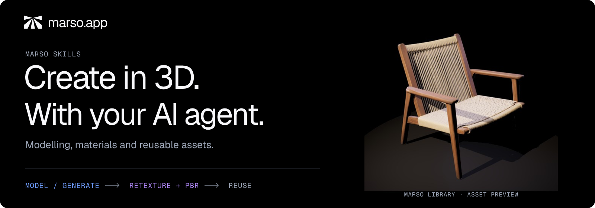
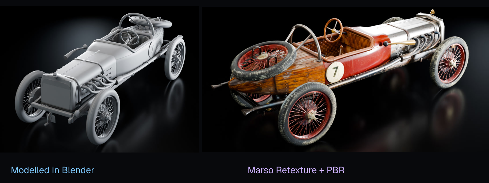
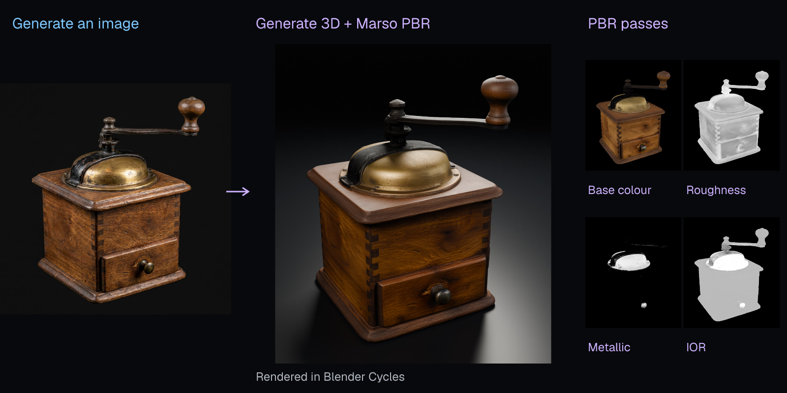
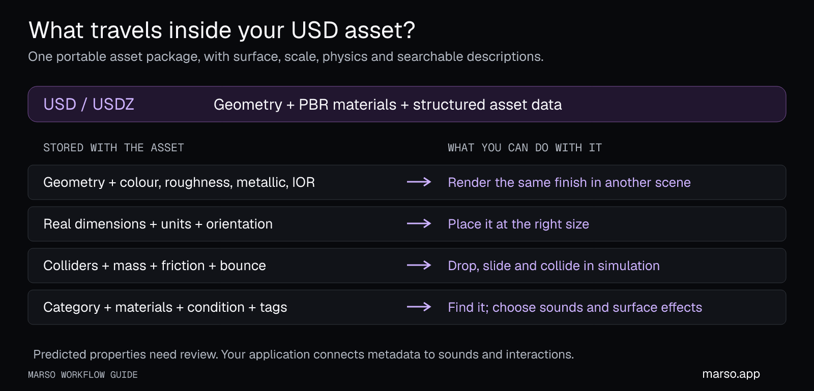
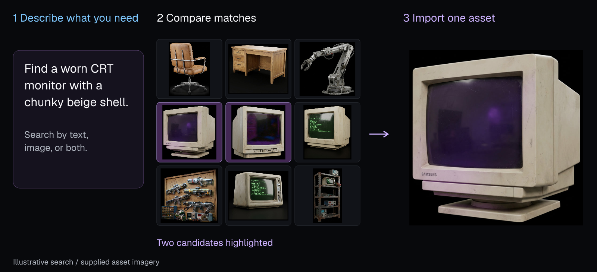
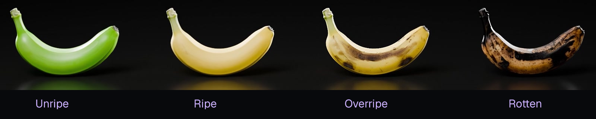
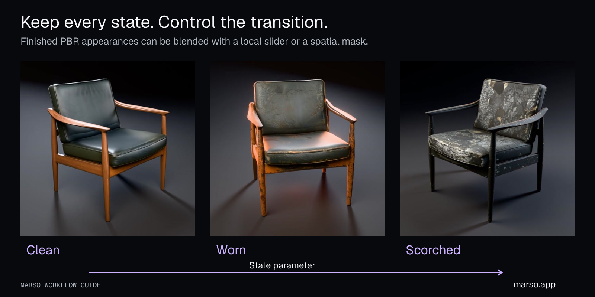
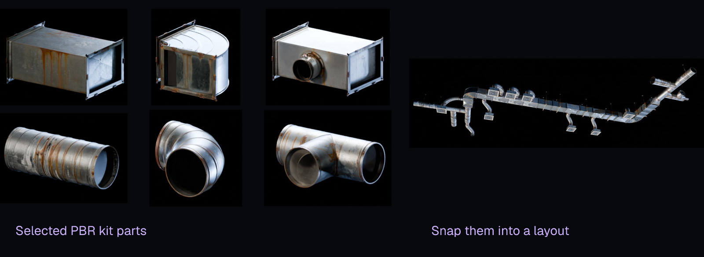
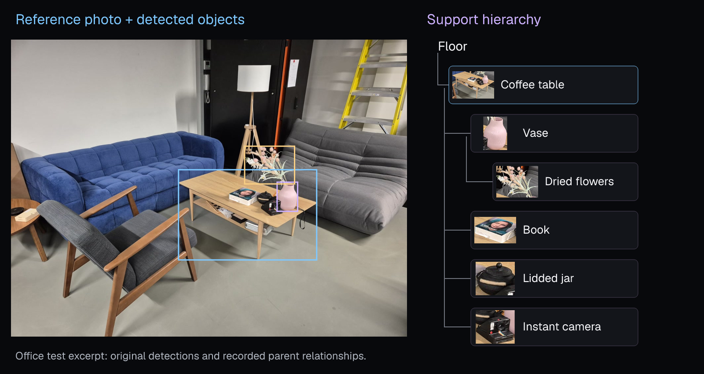

<p align="center">
  <a href="https://marso.app/"></a>
</p>

<table>
<tr>
<td width="64%" valign="top">

# Marso Skills

**Make an asset. Give it realistic materials. Keep it in a library your agent can use again.**

Marso is a platform for image and 3D generation, Retexture, PBR and asset search. These skills are workflow instructions that teach your agent how to use Marso—and how to model, build modular kits and assemble editable scenes in Blender.

[**Get started →**](#get-started) · [Learn by doing →](docs/workflows.md)

## Who is it for?

For **3D artists and designers** exploring materials and building reusable assets; **game and environment creators** making props, kits and scene variations; **simulation teams** working with enriched USD assets; and **people learning Blender with an agent** who want to understand the process as well as get a result.

You can start from a sentence, a photograph or an existing mesh. Choose generation when you want a new asset from an image. Choose agent modelling when editable construction, articulation or precise modular connections matter. Blender is the first supported application in this collection.

</td>
<td width="36%" valign="top">

### On this page

**🚀 Start here**

- [Install and connect](#get-started)
- [Learn with your agent](docs/workflows.md)
- [Keep everything updated](#stay-up-to-date)

**✨ Explore the workflows**

- [Model in Blender](#agents-model-in-blender-marso-textures--finishes-with-pbr)
- [Generate an asset + PBR](#generate-an-asset-from-an-image-complete-with-pbr)
- [Sim-ready USD](#get-a-usd-asset-you-can-render-find-and-simulate)
- [Search and reuse assets](#find-similar-assets-in-your-own-library)
- [Retexture and appearance states](#one-shape-many-appearances)
- [Build modular kits](#build-a-kit-assemble-many-layouts)
- [Rebuild a scene from photos](#turn-reference-images-into-an-editable-scene)

**📚 Go further**

- [Advanced workflows](#go-further)
- [All 14 skills](#available-skills)
- [Help and contributing](#help-and-contributing)

</td>
</tr>
</table>

## See what you can make

---

## Agents model in Blender, Marso textures & finishes with PBR

**Build the right shape first. Then give it the right surface.** The agent models editable geometry in Blender: proportions, separate parts, pivots and modular connections. You review the model before Marso Retexture and PBR finish it.

[](docs/assets/demos/agent-car-to-pbr.mp4?raw=true)

**🛠️ Skills:** [Model an asset](skills/blender/marso-blender-asset/SKILL.md) → [Retexture + PBR](skills/blender/marso-blender-texture/SKILL.md)

**💬 Try asking:**

> Model a cabinet with independently movable doors. Show me its proportions and pivots before texturing. Then use Marso for worn walnut and blackened steel fittings, and save the result for reuse.

[Watch the modelling-to-PBR example](docs/assets/demos/agent-car-to-pbr.mp4?raw=true) · [Learn modelling with an agent](docs/workflows.md#learn-modelling-with-an-agent)

---

## Generate an asset from an image, complete with PBR

**Generate image → Generate 3D → Generate PBR → enriched USD + your library.** Start with your own reference or ask Marso to generate one. The agent keeps the work in a relevant Marso Studio project so you can revisit its graph.

[](docs/assets/demos/generated-grinder-cycles.jpg)

**✨ Skills:** [Generate an image](skills/core/marso-image/SKILL.md) → [Generate an asset + PBR](skills/core/marso-generate/SKILL.md)

**💬 Try asking:**

> Use Marso to make a vintage coffee grinder with worn walnut, aged brass and black iron. Show me the generated image before making the 3D asset, then add PBR and save it to my Kitchen Props project.

Already have a mesh? Use PBR to finish its existing appearance, or Retexture first to change it. [Try your first generated asset →](docs/workflows.md#start-here-generate-your-first-asset)

**PBR—physically based rendering—gives the asset a material you can relight.** Colour, roughness, metallic and IOR describe its surface; the smaller views above show material passes on the finished mesh. [Understand PBR and its outputs →](docs/pbr-and-usd.md#what-is-pbr)

---

## Get a USD asset you can render, find and simulate

**After PBR, Marso packages and enriches the asset as USD—a process called minting.** USD—Universal Scene Description—holds the asset and its structured data; USDZ packages its dependencies. The result carries useful information about what the object is, what it is made of, its scale and how it can interact physically.



The table describes the available information groups. Fields depend on the asset and completed enrichment; your agent should verify the delivered USD, since PBR maps can finish before minting does.

| What travels with the asset | What you can use it for |
| --- | --- |
| Geometry, UVs, part transforms, material bindings and PBR maps | Render, relight and place the asset in another application. |
| Dimensions, stage units and up axis | Keep scale and orientation consistent across a scene. |
| Rigid-body settings, mass, colliders, collision approximation and physics assumptions | Give simulation a starting point for dropping, colliding and settling. |
| Density, static/dynamic friction and restitution | Describe material weight, resistance to sliding and bounce. |
| Name, descriptions, category, subcategory and semantic class labels | Help agents understand the object and choose the right asset. |
| Material class, substrate, finish and semantic material labels | Select appropriate contact sounds, surface effects or interaction rules. |
| Condition, cleanliness, style, setting, region and placement descriptions | Choose assets that fit a scene and drive condition-dependent behaviours. |
| Search aliases, tags, source identity, schema version and review flags | Find the asset again, retain provenance and identify predictions needing review. |

Your application connects these fields to its behaviour: material labels can select an impact sound; condition can select a surface effect; a simulator can read the authored physics. **This is the basis of Marso's sim-ready assets.** Inspect predicted values, colliders and scale in the target application; articulated mechanisms also need suitable joints.

[Explore the USD field guide](docs/pbr-and-usd.md#what-the-minted-usd-carries) · [Watch the simulation example](docs/assets/demos/sim-ready.mp4?raw=true)

---

## Find similar assets in your own library

**Each finished asset makes the next project faster.** Assets that complete the Marso PBR pipeline become reusable content in your personal library—including work modelled or retextured through the Blender add-on.

Your Studio project holds the creation graph; your library lets you find its finished assets again. Save the editable Blender scene separately as a `.blend` file.

Search with a description, an image, or both. The reference can be a photograph of the kind of object you want; it does not need to be the asset's original thumbnail. Review relevant matches, choose the saved asset, then import and reuse it.



**🔎 Skill:** [Search and reuse your library](skills/core/marso-library/SKILL.md)

**💬 Try asking:**

> Find a worn CRT monitor with a chunky beige shell in my Marso library. Show me two good matches, then import the one I choose into Blender.

*Illustrative search flow using supplied Marso asset imagery; not a recording of a live search.* Reuse preserves asset identity and avoids generating a replacement when the right object already exists.

---

## One shape, many appearances

**Keep the shape; change the surface.** A can can carry different labels, a chair can have different upholstery, and fruit can appear at different stages of ripeness. Each accepted look gets its own PBR set.

[](docs/assets/demos/banana-looks.mp4?raw=true)

**🎨 Skill:** [Retexture, appearance families and PBR](skills/blender/marso-blender-texture/SKILL.md)

> Make four appearances of this banana: unripe, ripe, overripe and rotten. Keep the shape, give each version PBR and save all four for reuse.

[Watch the banana appearances](docs/assets/demos/banana-looks.mp4?raw=true) · [Make a family of looks](docs/workflows.md#stock-a-scene-without-rebuilding-every-object)

Use independent branches from the original for alternative designs. Use a deliberate **state 1 → state 2 → state 3** chain when wear should accumulate, and generate PBR for every state. Compatible appearances can share geometry and UVs; the texture sets still consume memory.

### Make the appearance change over time

[](docs/assets/demos/appearance-states.mp4?raw=true)

In Blender, a slider or mask can blend the finished materials—for example, increasing rust, dirt or scorch over time, or only in a selected region. Preserve every endpoint so you can inspect and reuse it. Appearance changes, geometry damage and physics changes are separate controls.

**💬 Try asking:**

> Take this chair from clean to worn to scorched. Keep each state, generate PBR for each, then add a Blender slider to blend their appearance.

[Watch the chair transition](docs/assets/demos/appearance-states.mp4?raw=true) · [Try a state slider or mask](docs/workflows.md#appearance-changes-over-time)

---

## Build a kit, assemble many layouts

**Model and texture the masters once, then reuse them.** The agent plans dimensions, connectors and join positions before building. This is useful for architectural parts, furniture systems and other assets that need to fit together precisely.

[](docs/assets/demos/modular-ducts.mp4?raw=true)

**🧩 Skills:** [Build a kit](skills/blender/marso-blender-kit/SKILL.md) → [Compose with it](skills/blender/marso-blender-compose/SKILL.md)

**💬 Try asking:**

> Build a modular ventilation kit with straight ducts, elbows, junctions and vents. Agree the connectors first, show the geometry, then texture the masters with Marso and assemble two layouts.

[Watch the modular-kit example](docs/assets/demos/modular-ducts.mp4?raw=true) · [Build a kit with the agent](docs/workflows.md#build-a-modular-kit-then-use-it)

---

## Turn reference images into an editable scene

**Photos → scene graph → reviewed asset plan → Blender scene.** The agent identifies objects across photographs, matches repeated views and records what rests on what. You can choose what to model, generate, reuse, instance or build as a kit before creation begins.



This excerpt from a scene-decomposition test shows how a photograph becomes a support graph: the table supports the vase, and the vase holds the flowers. Those relationships guide placement while keeping each asset independently editable.

The scene stays editable: replace furniture, change finishes or build another layout. Empty-based groups prevent a table's mesh scale from also resizing objects supported by it. The agent analyses the photographs and uses the skills' local scripts to build the scene graph; Marso Detect Objects is an optional aid.

**🏗️ Skills:** [Decompose references](skills/core/marso-scene-decompose/SKILL.md) → [Plan the graph](skills/core/marso-scene-graph/SKILL.md) → [Build assets](skills/blender/marso-blender-scene-assets/SKILL.md) → [Place the scene](skills/blender/marso-blender-place-scene/SKILL.md)

**💬 Try asking:**

> Rebuild this room from these photos. Show me the scene graph first, search my library for reusable assets, then plan what to model or generate. Finish the visible furniture and props with Marso.

[Follow the complete scene workflow](docs/workflows.md#rebuild-a-reference-scene-in-blender) · [Check the Blender connection](docs/blender-setup.md)

---


## Get started

You need a Marso account for cloud generation, texturing and your library. Installing the skills supplies workflow instructions; connect the tools separately in step 2.

### 1. Install the skills 📦

**Codex, Claude Code and other supported local agents:** run this in PowerShell or Terminal on your computer, inside your project folder:

```bash
npx skills add mxr-software/marso-skills --skill '*'
```

Requires Node.js and Git. Choose your agent when prompted; add `--global` for use across projects. This installs the complete collection from `main` locally, not into a web chat account.

**Claude web or desktop:** open **Customize → Plugins → Add → Add marketplace → Add from a repository**, enter `mxr-software/marso-skills`, then install **marso**. Your plan and organisation settings must allow plugins.

<details>
<summary><strong>Claude Code plugin and OpenAI host options</strong></summary>

In a Claude Code conversation (v2.1.275+), the plugin alternative is:

```text
/plugin install marso --marketplace mxr-software/marso-skills
```

Use this instead of a duplicate standalone installation. For OpenAI, the documented local route is Codex. ChatGPT's skill/plugin surfaces and API hosts have different installation and tool-access requirements; this repository does not yet distribute an OpenAI marketplace plugin. [Choose your client →](docs/installation.md)

</details>

### 2. Connect the tools

Choose the route for what you want to do:

| Your workflow | Connect these tools |
| --- | --- |
| Model, texture or assemble scenes in Blender | Use an assistant with local Blender control. Install [Marso for Blender](https://marso.app/dashboard/plugins) and the [official Blender Lab MCP](https://www.blender.org/lab/mcp-server/). The add-on supplies Marso operations; Blender MCP controls Blender. A separate hosted Marso MCP is optional. |
| Generate images/assets or search your library without Blender | Connect the hosted Marso MCP to your Marso account in an assistant that supports it. Blender is not required for these cloud operations. Ask the agent to verify its Marso connection and choose a Studio project before creating anything. |

**Claude web/desktop:** installing the Marso plugin loads the skills, but does not by itself connect to Blender. Local modelling needs a client/session that can use Blender MCP; a cloud-only chat can use supported hosted Marso tools. Check the [client-specific installation guide](docs/installation.md) and [Blender connection guide](docs/blender-setup.md) before starting a Blender task.

**Blender route:** [follow the setup guide](docs/blender-setup.md), then ask:

> Use marso-blender-setup to check my Blender connection, Marso account, storage folders and library without generating anything. Tell me what is ready and what is missing.

**Cloud route:** ask:

> Check my hosted Marso connection and list my Studio projects without generating anything. Tell me which image, 3D, PBR and library tools are available.

### 3. Make something—and understand it

**With Blender:**

> Teach me while we make a small side table in Blender. Explain the modelling choices, show me the geometry before texturing, then use Marso for realistic materials and PBR. Save the file and show me where the asset lives in my library.

**Without Blender:**

> Use Marso to generate a weathered ceramic pot in a project called Garden Props. Explain each step, show me the image before generating 3D, then add PBR and show me the finished asset in my library.

[Your first project →](docs/getting-started.md) · [Learning prompts and recipes →](docs/workflows.md)

### Stay up to date

Rerun the skills installation command with the same agent and scope, or update the Marso plugin through your client's plugin controls. Update the Blender add-on and Blender MCP separately, then repeat the connection check. [Updates and troubleshooting →](docs/blender-setup.md#keep-the-components-up-to-date)

## Go further

| Goal | Start here |
| --- | --- |
| Learn the full image → 3D → PBR route | [Generate your first asset](docs/workflows.md#start-here-generate-your-first-asset) |
| Make reusable props with controlled geometry | [Learn modelling with an agent](docs/workflows.md#learn-modelling-with-an-agent) |
| Change the appearance of damage or wear with a material parameter | [Appearance states and transitions](docs/workflows.md#appearance-changes-over-time) |
| Fill shelves with many looks from a few shapes | [Appearance families](docs/workflows.md#stock-a-scene-without-rebuilding-every-object) |
| Build larger structures from reusable pieces | [Modular kits](docs/workflows.md#build-a-modular-kit-then-use-it) |
| Reconstruct and improve a photographed environment | [Scene workflow](docs/workflows.md#rebuild-a-reference-scene-in-blender) |


## Available skills

**14 skills, one collection.** Start with `marso` to coordinate a task, or use a specialist directly.

<details>
<summary><strong>Core workflows · 4 skills</strong></summary>

| Skill | What it does |
| --- | --- |
| [marso](skills/core/marso/SKILL.md) | Choose and coordinate workflows across creation, texturing, reuse and scenes. |
| [marso-image](skills/core/marso-image/SKILL.md) | Generate and edit images, appearance references and coordinated style variations. |
| [marso-generate](skills/core/marso-generate/SKILL.md) | Generate 3D assets using supported options and the user’s preferred models. |
| [marso-library](skills/core/marso-library/SKILL.md) | Find and reuse library assets, instances and original style sources. |

</details>

<details>
<summary><strong>Blender workflows · 6 skills</strong></summary>

| Skill | What it does |
| --- | --- |
| [marso-blender-setup](skills/blender/marso-blender-setup/SKILL.md) | Install, configure, update and troubleshoot the Marso connection. |
| [marso-blender-asset](skills/blender/marso-blender-asset/SKILL.md) | Model editable assets from briefs, dimensions and images. |
| [marso-blender-texture](skills/blender/marso-blender-texture/SKILL.md) | Prepare assets for Marso, retexture, restyle and generate PBR. |
| [marso-blender-kit](skills/blender/marso-blender-kit/SKILL.md) | Decompose references into reusable parts and build fitting kits. |
| [marso-blender-compose](skills/blender/marso-blender-compose/SKILL.md) | Assemble existing kits using connection frames and fit checks. |
| [marso-blender-render](skills/blender/marso-blender-render/SKILL.md) | Optimize render settings, GPU memory and instances; create requested images. |

</details>

<details>
<summary><strong>Scene workflows · 4 skills</strong></summary>

| Skill | What it does |
| --- | --- |
| [marso-scene-decompose](skills/core/marso-scene-decompose/SKILL.md) | Identify objects in photographs and build a scene graph with an interactive viewer. |
| [marso-scene-graph](skills/core/marso-scene-graph/SKILL.md) | Plan unique assets, counts, reference briefs and creation routes. |
| [marso-blender-scene-assets](skills/blender/marso-blender-scene-assets/SKILL.md) | Create the planned scene assets in Marso through Blender. |
| [marso-blender-place-scene](skills/blender/marso-blender-place-scene/SKILL.md) | Import and place assets with an editable transform hierarchy. |

</details>

See [compatibility and verification status](docs/compatibility.md) for required capabilities and testing limits across the collection.

## Help and contributing

Start with [installation](docs/installation.md), [Blender setup](docs/blender-setup.md) or [compatibility and verification status](docs/compatibility.md). For a problem, [open an issue](https://github.com/mxr-software/marso-skills/issues) with your assistant, Blender/add-on versions and the step that failed. Keep credentials and private project data out of reports.

Skills use the shared `SKILL.md` format. Install each complete folder with its references and scripts. See [contributing](CONTRIBUTING.md) for authoring and validation.

Most skills use [Apache-2.0](LICENSE). The four scene skills have their own proprietary `LICENSE.txt` files permitting installation and use with Marso. Blender, its MCP and the Marso add-on retain their own licences. [Demo and artwork notes](docs/assets/README.md) distinguish product demonstrations from installation or agent benchmarks.
