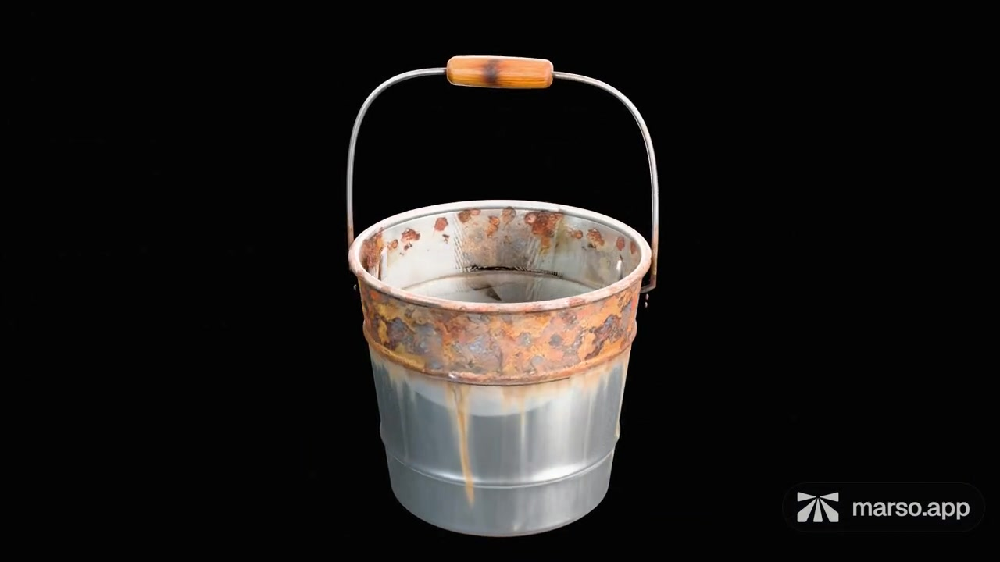
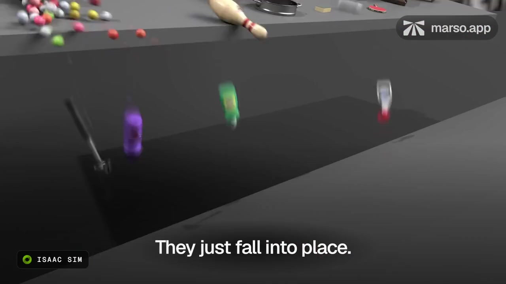

<p align="center">
  <a href="https://marso.app/"></a>
</p>

# Marso Skills

**Make an asset. Give it realistic materials. Keep it in a library your agent can use again.**

Marso connects image and 3D generation, Retexture, PBR and asset search. These skills teach your agent how to use that toolkit—and how to model, build modular kits and assemble editable scenes in Blender.

[Get started](#get-started) · [See what you can make](#see-what-you-can-make) · [Learn by doing](docs/workflows.md) · [Advanced workflows](#go-further) · [All skills](#available-skills)

## Who is it for?

For **3D artists and designers** exploring materials and building reusable assets; **game and environment creators** making props, kits and scene variations; **simulation teams** working with enriched USD assets; and **people learning Blender with an agent** who want to understand the process as well as get a result.

You can start from a sentence, a photograph or an existing mesh. Choose generation when you want a new asset from an image. Choose agent modelling when editable construction, articulation or precise modular connections matter. Blender is the first supported application in this collection.

## See what you can make

| Model with an agent, finish with Marso | Build a kit, assemble many layouts |
| --- | --- |
| [](docs/assets/demos/agent-model-to-pbr.mp4?raw=true) | [](docs/assets/demos/modular-ducts.mp4?raw=true) |
| [Watch: modelling → Retexture/PBR](docs/assets/demos/agent-model-to-pbr.mp4?raw=true) · 18 seconds | [Watch: reusable duct kit → assembly](docs/assets/demos/modular-ducts.mp4?raw=true) · 32 seconds |

Short, silent excerpts from Marso demonstrations. Click a preview to open or download the MP4; GitHub does not play these repository files inline. [More examples and repeatable prompts →](docs/workflows.md)

### Create an asset from an idea

**Generate image → Generate 3D → Generate PBR → minted USD + your library**

Describe an object, explore its image, turn the chosen image into a mesh, then give it a physically based material. Already have a reference? Start there. Already have the mesh? Go straight to PBR, or Retexture first when you want a different appearance. The agent keeps the work in a relevant Marso Studio project so you can revisit its graph.

<table>
  <tr><td width="50%"></td><td width="50%"></td></tr>
  <tr><td>Generated image</td><td>PBR 3D asset · Marso example</td></tr>
</table>

> Use Marso to make a weathered ceramic plant pot. Show me the generated image before making the 3D asset, then add PBR and save it to my Garden Props project.

### PBR makes the surface respond to light

**PBR—physically based rendering—describes how a material behaves under light.** Colour alone cannot describe the soft sheen of worn leather, the roughness of rust or the reflections of exposed metal. Marso predicts those surface properties and creates the maps for a material that can be relit.

After PBR, Marso automatically **mints an enriched USD asset**. Alongside the mesh and textures, the package can carry scale, semantic labels, material descriptions, colliders and physical properties such as mass, density, friction and restitution. This is the foundation of Marso's sim-ready assets.

[](docs/assets/demos/sim-ready.mp4?raw=true)

[Watch the simulation example →](docs/assets/demos/sim-ready.mp4?raw=true) · [Understand PBR, minting and USD →](docs/pbr-and-usd.md)

That information is useful beyond rendering: a game can use material labels to select impact sounds, or a simulator can consume physics properties. Your application connects the data to its behaviour; joints, special effects and target-specific validation remain deliberate work. The demo's numeric overlays are illustrative; your agent should inspect the actual minted file.

### Build your own searchable asset library

**The next project should start with what you already made.** Assets that complete the Marso PBR pipeline become reusable content in your personal library—including work created or retextured through the Blender add-on.

Your agent can find assets by meaning and by image, then bring the chosen result into a scene. A tight crop of a chair and a short description can be more useful than remembering its filename. Reusing an existing asset keeps a world consistent and avoids spending time and generation resources making the same thing again.

> Find the worn leather chair I made earlier. Show me the closest matches, then use the one I choose around this table with shared instances.

### Turn reference images into an editable Blender scene

**Photos → scene skills → scene graph → asset plan → Blender scene**

The agent uses the decomposition skills to identify objects across photographs, match repeated views and record what rests on what. You can review the scene graph and choose what to **model, generate, reuse, instance or build as a kit**. The agent then creates and places the assets in Blender, using Marso for the generation, materials and library work.

This gives you a scene you can improve and rearrange: replace the furniture, change its condition or build a different layout. Empty-based groups keep it editable without making a table's mesh scale also resize the objects sitting on it. Marso's built-in Detect Objects is available as an optional aid; it is not required for the skills-led route.

> Rebuild this room from these photos. Show me the scene graph first, search my library for reusable assets, then plan what to model or generate. Finish the visible furniture and props with Marso.

[See the complete scene workflow →](docs/workflows.md#rebuild-a-reference-scene-in-blender) Generation/import commands depend on the loaded add-on's capabilities; [setup checks them](docs/blender-setup.md).

### One mesh, many looks—and changing states

Retexture an existing mesh without rebuilding its shape or UV layout. Give it different finishes, create a family of product labels, or show an object becoming dirty, rusty or scorched. Each look gets its own PBR material set.

<p align="center"><a href="docs/assets/demos/appearance-states.mp4?raw=true"></a></p>

[Watch the 8-second appearance transition →](docs/assets/demos/appearance-states.mp4?raw=true)

Use independent branches from the original for alternative looks. For cumulative wear, use **state 1 → state 2 → state 3**, with PBR generated for each state. In Blender, a slider or mask can control the transition between the finished materials.

Copies can share the same geometry, reducing mesh duplication. Different looks still use texture memory, and a transition shader has its own cost. The skills keep those choices tied to the scene's needs. [Try state transitions, appearance families and efficient reuse →](docs/workflows.md)

### Model precisely, then make it look real

An agent can build an editable asset in Blender with deliberate dimensions, pivots, separate moving parts or matching modular interfaces. Review the geometry first, then use Marso to Retexture it and generate PBR. The resulting Marso asset joins your library for the next project.

> Model a cabinet with independently movable doors. Show me the proportions and pivots before texturing. Then use Marso for worn walnut and blackened steel fittings, and save the result for reuse.

For kits, the agent plans connectors and joins before building the parts. Texture the masters once, then assemble multiple arrangements. [Watch the Blender Retexture walkthrough](docs/assets/demos/retexture-blender.mp4?raw=true) or [try a modular-kit recipe](docs/workflows.md#build-a-modular-kit-then-use-it).

## Get started

### 1. Install the skills

**Codex, Claude Code and other supported local agents:** run this in PowerShell or Terminal on your computer, inside your project folder:

```bash
npx skills add mxr-software/marso-skills --skill '*'
```

Requires Node.js and Git. Choose your agent when prompted; add `--global` for use across projects. This installs the complete collection from `main` locally, not into a web chat account.

**Claude web or desktop:** open **Customize → Plugins → Add → Add marketplace → Add from a repository**, enter `mxr-software/marso-skills`, then install **marso**. Your plan and organisation settings must allow plugins.

<details>
<summary><strong>Claude Code plugin and OpenAI host options</strong></summary>

In a Claude Code conversation (v2.1.275+), the plugin alternative is:

```text
/plugin install marso --marketplace mxr-software/marso-skills
```

Use this instead of a duplicate standalone installation. For OpenAI, the documented local route is Codex. ChatGPT's skill/plugin surfaces and API hosts have different installation and tool-access requirements; this repository does not yet distribute an OpenAI marketplace plugin. [Choose your client →](docs/installation.md)

</details>

### 2. Connect the tools

For agent modelling in Blender, install **[Marso for Blender](https://marso.app/dashboard/plugins)** and the **[official Blender Lab MCP](https://www.blender.org/lab/mcp-server/)**. The add-on supplies Marso operations; Blender MCP lets the agent control Blender. A separate hosted Marso MCP is optional for this route.

[Follow the Blender setup guide →](docs/blender-setup.md) Then ask:

> Use marso-blender-setup to check my Blender connection, Marso account, storage folders and library without generating anything. Tell me what is ready and what is missing.

### 3. Make something—and understand it

> Teach me while we make a small side table in Blender. Explain the modelling choices, show me the geometry before texturing, then use Marso for realistic materials and PBR. Save the file and show me where the asset lives in my library.

[Your first project →](docs/getting-started.md) · [Learning prompts and recipes →](docs/workflows.md)

### Stay up to date

Rerun the skills installation command with the same agent and scope, or update the Marso plugin through your client's plugin controls. Update the Blender add-on and Blender MCP separately, then repeat the connection check. [Updates and troubleshooting →](docs/blender-setup.md#keep-the-components-up-to-date)

## Go further

| Goal | Start here |
| --- | --- |
| Learn the full image → 3D → PBR route | [Generate your first asset](docs/workflows.md#start-here-generate-your-first-asset) |
| Make reusable props with controlled geometry | [Learn modelling with an agent](docs/workflows.md#learn-modelling-with-an-agent) |
| Drive damage or wear with a material parameter | [Appearance states and transitions](docs/workflows.md#appearance-changes-over-time) |
| Fill shelves with many looks from a few shapes | [Appearance families](docs/workflows.md#stock-a-scene-without-rebuilding-every-object) |
| Build larger structures from reusable pieces | [Modular kits](docs/workflows.md#build-a-modular-kit-then-use-it) |
| Reconstruct and improve a photographed environment | [Scene workflow](docs/workflows.md#rebuild-a-reference-scene-in-blender) |


## Available skills

**14 skills, one collection.** Start with `marso` to coordinate a task, or use a specialist directly.

<details>
<summary><strong>Core workflows · 4 skills</strong></summary>

| Skill | What it does |
| --- | --- |
| [marso](skills/core/marso/SKILL.md) | Choose and coordinate workflows across creation, texturing, reuse and scenes. |
| [marso-image](skills/core/marso-image/SKILL.md) | Generate and edit images, appearance references and coordinated style variations. |
| [marso-generate](skills/core/marso-generate/SKILL.md) | Generate 3D assets using supported options and the user’s preferred models. |
| [marso-library](skills/core/marso-library/SKILL.md) | Find and reuse library assets, instances and original style sources. |

</details>

<details>
<summary><strong>Blender workflows · 6 skills</strong></summary>

| Skill | What it does |
| --- | --- |
| [marso-blender-setup](skills/blender/marso-blender-setup/SKILL.md) | Install, configure, update and troubleshoot the Marso connection. |
| [marso-blender-asset](skills/blender/marso-blender-asset/SKILL.md) | Model editable assets from briefs, dimensions and images. |
| [marso-blender-texture](skills/blender/marso-blender-texture/SKILL.md) | Prepare assets for Marso, retexture, restyle and generate PBR. |
| [marso-blender-kit](skills/blender/marso-blender-kit/SKILL.md) | Decompose references into reusable parts and build fitting kits. |
| [marso-blender-compose](skills/blender/marso-blender-compose/SKILL.md) | Assemble existing kits using connection frames and fit checks. |
| [marso-blender-render](skills/blender/marso-blender-render/SKILL.md) | Optimize render settings, GPU memory and instances; create requested images. |

</details>

<details>
<summary><strong>Scene workflows · 4 skills</strong></summary>

| Skill | What it does |
| --- | --- |
| [marso-scene-decompose](skills/core/marso-scene-decompose/SKILL.md) | Identify objects in photographs and build a scene graph with an interactive viewer. |
| [marso-scene-graph](skills/core/marso-scene-graph/SKILL.md) | Plan unique assets, counts, reference briefs and creation routes. |
| [marso-blender-scene-assets](skills/blender/marso-blender-scene-assets/SKILL.md) | Create the planned scene assets in Marso through Blender. |
| [marso-blender-place-scene](skills/blender/marso-blender-place-scene/SKILL.md) | Import and place assets with an editable transform hierarchy. |

See [compatibility and verification status](docs/compatibility.md) for required capabilities and testing limits.

</details>

## Help and contributing

Start with [installation](docs/installation.md), [Blender setup](docs/blender-setup.md) or [compatibility and verification status](docs/compatibility.md). For a problem, [open an issue](https://github.com/mxr-software/marso-skills/issues) with your assistant, Blender/add-on versions and the step that failed. Keep credentials and private project data out of reports.

Skills use the shared `SKILL.md` format. Install each complete folder with its references and scripts. See [contributing](CONTRIBUTING.md) for authoring and validation.

Most skills use [Apache-2.0](LICENSE). The four scene skills have their own proprietary `LICENSE.txt` files permitting installation and use with Marso. Blender, its MCP and the Marso add-on retain their own licences. [Demo and artwork notes](docs/assets/README.md) distinguish product demonstrations from installation or agent benchmarks.
