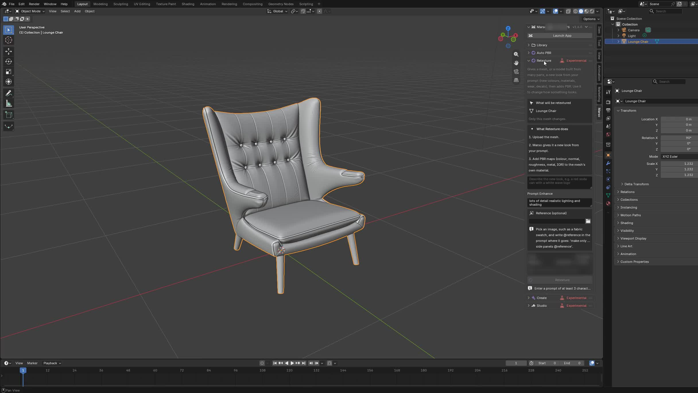

# Connect your agent, Blender and Marso

[Back to Marso Skills](../README.md) · [Install the skills](installation.md) · [Make your first asset](getting-started.md)

There are three pieces:

| Piece | Its job |
| --- | --- |
| Marso skills | Tell the agent how to plan, build, inspect and finish the work. |
| Official Blender MCP | Let a compatible local assistant inspect and control Blender. |
| Marso Blender add-on | Connect Blender to Marso generation, Retexture, PBR and the library. |

For this Blender route, a separate hosted Marso MCP is optional. Installing skills does not install either Blender component. A web chat also needs a supported route to your computer before it can control local Blender.

## 1. Install the Marso add-on

1. Sign in at [Marso Dashboard → Plugins](https://marso.app/dashboard/plugins) and download **Marso for Blender**.
2. Use **Marso 1.12.1 or later with Blender 5.2 or later** as the baseline for this guide. Check the current package's requirements before installing a newer release.
3. In Blender, open **Edit → Preferences → Get Extensions → Install from Disk** and select the downloaded extension ZIP. Enable Marso.
4. In the 3D Viewport, press **N** to open the sidebar and find **Marso**.
5. In the add-on preferences, configure your API key, Cache Path and Downloads Path. Choose writable folders for your own files. Enter the key in Blender, never in a chat or screenshot.
6. Enable Blender's **Online Access** for Marso's network operations and save preferences.

Keep Downloads stable: it contains assets and textures your saved scenes may reference. It is not a disposable cache.

*Real Blender 5.2 capture from the Marso 1.6 tutorial. It shows where the Marso sidebar lives; newer add-ons have additional controls and may arrange them differently.*

## 2. Install the official Blender MCP

Use [Blender Lab's MCP Server page](https://www.blender.org/lab/mcp-server/) and its [setup instructions](https://projects.blender.org/lab/blender_mcp/wiki/Setup). It has a Blender-side add-on and a client-side MCP server; you need both.

Install the Blender Lab add-on using that page's extension link or Install from Disk. For an assistant that supports MCP bundles, use the project's released `.mcpb` package. Otherwise follow its documented server configuration for your client. Keep Blender open and configure the connection in the assistant you will actually use.

Other projects use the name “Blender MCP.” These instructions refer to **Blender Lab's official project**. Preserve an already-working alternative when the user deliberately chooses it; do not mix one project's add-on with another project's server instructions.

## 3. Verify the connection

Ask your agent:

> Use marso-blender-setup to check my setup without generating anything. Confirm you can inspect this Blender session, read the loaded Marso version, make a fresh authenticated Marso request and access my library. Tell me exactly what is missing.

A successful check establishes:

- The agent sees the intended Blender scene, not a different open session.
- Marso is enabled, Online Access is on and the required folders are usable.
- A fresh non-generating request succeeds; cached thumbnails alone do not prove connectivity.
- The library loads, including a valid empty library for a new account.
- The commands needed for the chosen workflow are available in the loaded add-on.

**Do not turn on every connection switch.** Marso's **Connect to Marso Agents** is for its hosted relay. **Allow Control Server** enables a separate local HTTP interface. Neither is automatically required when the official Blender MCP calls the add-on inside Blender.

## 4. Choose where the work belongs

For creation or Retexture, select a relevant project in the Marso panel's **Save to** picker, or ask the agent to create one. Save the `.blend` and have the agent verify the destination before starting. Browsing a project in Library does not select that creation destination. Auto PBR uses its own queue, so verify its actual result location separately.

> Use a Marso Studio project called Workshop Props for this task. Confirm the destination, then help me make the first asset.

## Keep the components up to date

| Component | Update and verify |
| --- | --- |
| Skills installed with the terminal command | Rerun the same command with the same agent and project/global scope. Start a new session if needed, then ask the agent to list the installed Marso skills. |
| Claude plugin | Refresh the Marso marketplace and update the installed `marso` plugin through Claude's plugin controls. Avoid installing a second standalone copy over it. |
| Marso add-on | Use **Check for Updates** in its header menu, download the current extension from Dashboard → Plugins, and install it through Blender. Preserve the scene and let active jobs finish first. Verify the loaded version afterwards. |
| Official Blender MCP | Update its Blender-side add-on and client-side server according to Blender Lab's instructions, then repeat the scene-inspection check. |

The add-on's update check opens or points to a download; it does not prove the new build has been installed. For a detailed repair or update, ask the setup skill to diagnose the actual state.

## If something is missing

- **No Marso tab:** check installation, compatibility and the enabled state in Preferences.
- **Marso works but the agent cannot inspect Blender:** check the assistant's Blender MCP connection and which session it reaches.
- **The library displays old content:** verify a fresh request and account configuration before clearing any cache.
- **A scene-generation command is unavailable:** update the loaded add-on or continue the model/reuse parts of the plan. The scene skills can decompose photographs locally; missing cloud commands do not invalidate the graph.

See [compatibility](compatibility.md) for the difference between source inspection, package checks and live workflow testing.
