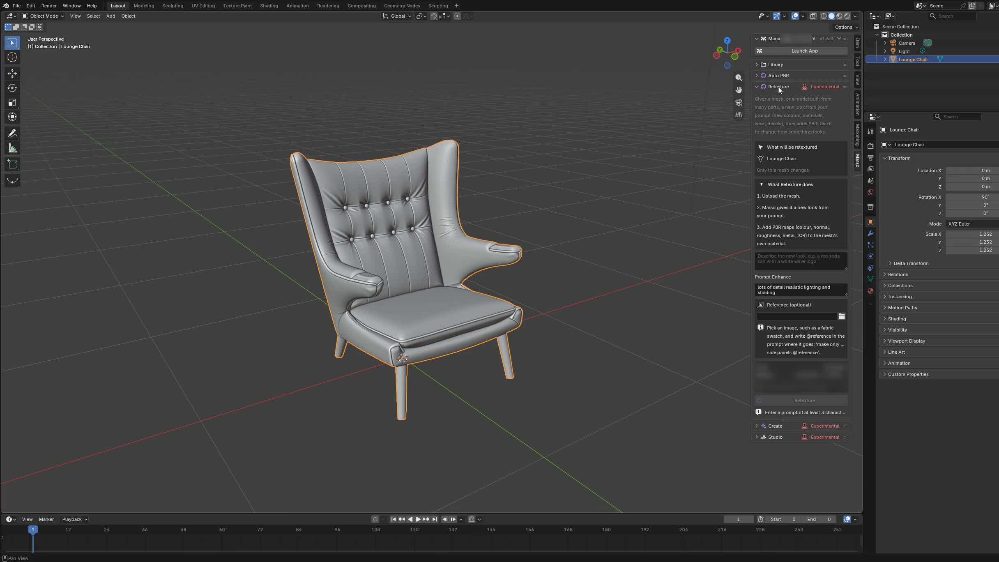

# Connect your agent, Blender and Marso

[Back to Marso Skills](../README.md) · [Install the skills](installation.md) · [Make your first asset](getting-started.md)

There are three pieces:

| Piece | Its job |
| --- | --- |
| Marso skills | Tell the agent how to plan, build, inspect and finish the work. |
| Official Blender MCP | Let a compatible local assistant inspect and control Blender. |
| Marso Blender add-on | Connect Blender to Marso generation, Retexture, PBR and the library. |

Every Marso skill works through these two Blender components. Installing skills does not install either of them. A web chat also needs a supported route to your computer before it can control local Blender.

## 1. Install the Marso add-on

1. Use **Blender 5.2 or later**. This guide was checked against **Marso 1.21.2**.
2. In Blender, open **Edit → Preferences → System** and enable **Allow Online Access**.
3. Open **Get Extensions**, open its repository menu and choose **Add Remote Repository**.
4. Paste `https://marso.app/plugins/blender/repo/index.json`, leave **Access Token** empty and add the repository.
5. Search for **Marso**, install it and enable it. Installing needs no Marso account or key.
6. In the 3D Viewport, press **N** to open the sidebar and find **Marso**. A **Get started** card lists whatever is still missing.
7. Create an API key in the Marso dashboard under **Settings → API Keys**. In the add-on preferences, paste the key and set the Cache Path and Downloads Path to writable folders of your own. Enter the key in Blender, never in a chat or screenshot.

If the repository cannot be reached, download the extension ZIP from the [Marso for Blender page](https://marso.app/plugins/blender) and use **Install from Disk** instead.

Keep Downloads stable: it contains assets and textures your saved scenes may reference. It is not a disposable cache.

*Real Blender 5.2 capture from the Marso 1.6 tutorial. It shows where the Marso sidebar lives; newer add-ons have additional controls and may arrange them differently.*

## 2. Install the official Blender MCP

Use [Blender Lab's MCP Server page](https://www.blender.org/lab/mcp-server/) and its [setup instructions](https://projects.blender.org/lab/blender_mcp/wiki/Setup). It comes in two halves, and you need both:

| Half | Where it goes | Its job |
| --- | --- | --- |
| Blender MCP add-on | Blender | Waits for your assistant on this computer, on port 9876 unless you change it. |
| Blender MCP server | Your assistant | Reaches that add-on, so the assistant can inspect and control Blender. |

Install the Blender MCP add-on using that page's extension link or Install from Disk. Its preferences show the port and whether its server is running; **Auto Start** starts it with Blender.

Then add the server to the assistant you will actually use:

- **Claude desktop app:** open **Settings → Extensions**, find **Blender** by Blender Lab in the extension directory and install it. It needs no settings, and the app's Code tab uses it too.
- **Other assistants:** for one that supports MCP bundles, use the project's released `.mcpb` package. Otherwise follow Blender Lab's server configuration for your client.

Start a new chat or session afterwards, so the assistant loads the Blender tools. Installing Blender MCP gives the assistant Blender; the Marso skills ([install them](installation.md)) tell it how to use Marso there.

### The port

The two halves meet on port 9876 unless you change it, so you do not tell the assistant a port. Change it only when something else on your computer already uses 9876:

- Set the new port in the Blender MCP add-on's preferences.
- Set the same port as `BLENDER_MCP_PORT` in the environment of the assistant's Blender MCP server entry. Claude's Blender extension has no port setting, so keep 9876 with it.

Keep one Blender open while the assistant works. A second copy on the same port may not report a clash, and the assistant can then reach either one. To control two at once, give each copy its own port and add a server entry for each.

Other projects use the name “Blender MCP.” These instructions refer to **Blender Lab's official project**. Preserve an already-working alternative when the user deliberately chooses it; do not mix one project's add-on with another project's server instructions.

## 3. Verify the connection

Ask your agent:

> Use marso-blender-setup to check my setup without generating anything. Confirm you can inspect this Blender session, read the loaded Marso version, make a fresh authenticated Marso request and access my library. Tell me exactly what is missing.

A successful check establishes:

- The agent sees the intended Blender scene, not a different open session.
- Marso is enabled, Online Access is on and the required folders are usable.
- A fresh non-generating request succeeds; cached thumbnails alone do not prove connectivity.
- The library loads, including a valid empty library for a new account.
- The commands needed for the chosen workflow are available in the loaded add-on.

**Do not turn on every connection switch.** The add-on's **Connect to Marso Agents** and **Allow Control Server** are separate features for other integrations. The skills need neither: the official Blender MCP calls the add-on inside Blender.

## 4. Choose where the work belongs

For creation or Retexture, select a relevant project in the Marso panel's **Save to** picker, or ask the agent to create one. Save the `.blend` and have the agent verify the destination before starting. Browsing a project in Library does not select that creation destination. Auto PBR uses its own queue, so verify its actual result location separately.

> Use a Marso Studio project called Workshop Props for this task. Confirm the destination, then help me make the first asset.

## Keep the components up to date

| Component | Update and verify |
| --- | --- |
| Skills installed with the terminal command | Rerun the same command with the same agent and project/global scope. Start a new session if needed, then ask the agent to list the installed Marso skills. |
| Claude plugin | Refresh the Marso marketplace and update the installed `marso` plugin through Claude's plugin controls. Avoid installing a second standalone copy over it. |
| Marso add-on | When a newer version is published, **Check for Updates** at the top of the Marso panel becomes **Update to X**. Press it: Blender stays open and your key, paths and settings are kept. Let active jobs finish first, and verify the loaded version afterwards. |
| Official Blender MCP | Update its Blender-side add-on and client-side server according to Blender Lab's instructions, then repeat the scene-inspection check. |

The update is one click from the panel and needs no Marso key. For a detailed repair or update, ask the setup skill to diagnose the actual state.

## If something is missing

- **No Marso tab:** check installation, compatibility and the enabled state in Preferences.
- **Marso works but the agent cannot inspect Blender:** check that the Blender MCP add-on's preferences say its server is running, that the assistant has the Blender MCP server, and that both use the same [port](#the-port).
- **The agent sees a different Blender scene:** another Blender is open on the same port. Close it, or give each copy its own [port](#the-port).
- **The library displays old content:** verify a fresh request and account configuration before clearing any cache.
- **A scene-generation command is unavailable:** update the loaded add-on or continue the model/reuse parts of the plan. The scene skills can decompose photographs locally; missing cloud commands do not invalidate the graph.

See [compatibility](compatibility.md) for the difference between source inspection, package checks and live workflow testing.
