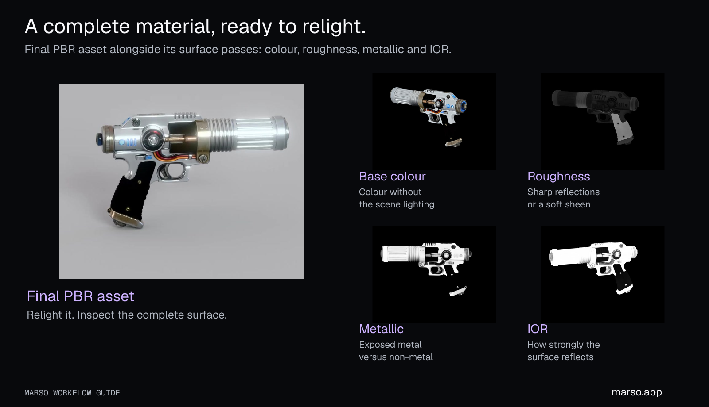

# From a good-looking mesh to a reusable asset

[Back to Marso Skills](../README.md) · [Try a workflow](workflows.md)

## What is PBR?

PBR means **physically based rendering**. A colour texture describes what a surface looks like; PBR describes how it responds to light. That is why brushed metal, worn leather and painted wood can feel different even when they have similar colours.

| Surface information | What you see |
| --- | --- |
| Base colour / albedo | The surface colour and artwork. |
| Roughness | Broad, soft reflections or sharper highlights. |
| Metallic | The difference between a metal surface and a non-metal coating. |
| Normal | Fine surface relief without adding geometry. |
| Index of refraction (IOR), when supplied | A material property used in its light response. |

Marso predicts material properties from the asset's appearance. These are predictions, not measurements of the original object. Use the maps actually returned by the operation, then review the result under more than one lighting condition.

Generate PBR keeps the existing appearance as its starting point. **Retexture changes the appearance first, then generates PBR.** Use Retexture for a new finish; use PBR alone when you already like the colour texture.

## What “minted” means in Marso

Completed PBR assets go through **USD minting**: Marso packages the asset and enriches it with information for reuse and simulation. USD is Universal Scene Description; USDZ packages a USD asset and its dependencies together. Minting here means creating that enriched asset package.

## What the minted USD carries

The table below covers the useful field groups in Marso's minted package and the enrichment read by the Blender add-on. Fields vary with the asset and minting result; inspect the delivered file for its actual values. This is a guide to Marso's package, not a catalogue of every field the USD standard can represent.

| Information in the package | Why it matters |
| --- | --- |
| Geometry, UV coordinates, part transforms and material bindings | Reconstruct the asset and connect each surface to the correct material. |
| PBR textures and material inputs | Relight colour, metal, coatings and fine surface detail in a compatible renderer. |
| Stage units (`metersPerUnit`) and up axis | Interpret distances and orientation consistently between applications. |
| Width, depth and height in metres | Plan room fit, clearances, placement and meaningful physical scale. |
| Rigid-body enabled state and kinematic state | Distinguish a simulated moving body from an externally driven body. |
| Mass | Determine the body's inertia in translation and its response to forces and impacts. |
| Collision meshes and approximation type | Determine where contact occurs; inspect concave shapes and openings in the intended simulator. |
| Density | Provide a physical material property that can inform mass calculations and plausibility checks. |
| Static friction | Describe resistance before two contacting surfaces begin sliding. |
| Dynamic friction | Describe resistance while those surfaces are sliding. |
| Restitution | Describe the bounciness of contact. |
| Physics preset and hollow/solid description | Explain the assumptions behind predicted physical properties and guide review. |
| Display name, short and long descriptions | Give agents a useful human-readable identity and description. |
| Category, subcategory and detail | Group objects by type and distinguish related uses. |
| Material class, substrate, substrate detail and finish | Identify the substance and finish—for example, a metal substrate with a painted finish—for sound selection or surface effects. |
| Condition and cleanliness | Select new, worn, dirty or damaged-looking assets; connect the chosen state to application behaviour. |
| Placement, setting, style period and region | Help choose contextually appropriate assets and plausible locations. |
| Search aliases and descriptive tags | Find the asset through different names or descriptive concepts. |
| Semantic class and material labels, including Wikidata identifiers | Supply machine-readable meaning for categorisation, datasets and rules across tools. |
| USD asset identity and enrichment schema version | Retain the source identity and interpret the metadata format correctly. |
| Review flag and review reasons | Identify enrichment that should be checked by a person before relying on it. |

This enrichment is what Marso calls **sim-ready**. An application still needs to read the supported USD fields, and a particular use may need review of scale, collision shape or predicted physical properties. A hinged mechanism also needs appropriate joints and articulation; PBR does not infer a working rig from every mesh.

**Wait for minting to finish.** PBR maps may be ready while USD enrichment is still running. A basic USD fallback is not evidence that enrichment succeeded. Ask your agent to verify the minted result and retain its library identity.

[Watch the simulation excerpt →](assets/demos/sim-ready.mp4?raw=true) The film shows Marso assets in Isaac Sim. Its numeric metadata overlays are illustrative; inspect your own minted file for its actual values.

Standard USD/UsdPhysics fields carry the physical schemas and stage conventions. Marso's additional descriptions live in asset enrichment metadata; an application must read that metadata to use it. The Blender add-on reads supported enrichment from the minted USD and retains it as asset information on imported objects. Converting to another format can lose it.

## Use the information for more than rendering

A game can use a material label to choose a metal impact sound, or a surface condition to select interaction effects. A simulation can consume the authored collision and physics properties. An asset-search workflow can use appearance and meaning to find the right prop again.

These are uses for the asset's data, not an automatic sound-effect or gameplay generator. Your engine or application must connect the data to the behaviour you want. Exporting to a different format can omit USD metadata or custom shaders, so retain the minted USDZ as well as any engine-specific version.

## Your library becomes part of the workflow

Assets that complete Marso's PBR pipeline become reusable content in your personal Marso library, including assets made or retextured through the Blender add-on. Keep them in the relevant Studio project so the work remains understandable later.

Your agent can search the library by a short description, an object image, or both where the connection supports full-library search. It can then reuse the actual asset instead of creating a similar one from scratch. Reuse preserves a project's visual language and avoids unnecessary modelling or generation.

> Find the worn leather chair I made earlier. Show the closest matches, import the one I choose and place six shared instances around this table.

For a useful handoff, keep the original source, final asset ID, project, chosen appearance and local file together. A folder of downloaded files is useful; a searchable library with stable asset identities is far more useful for the next agent task.
