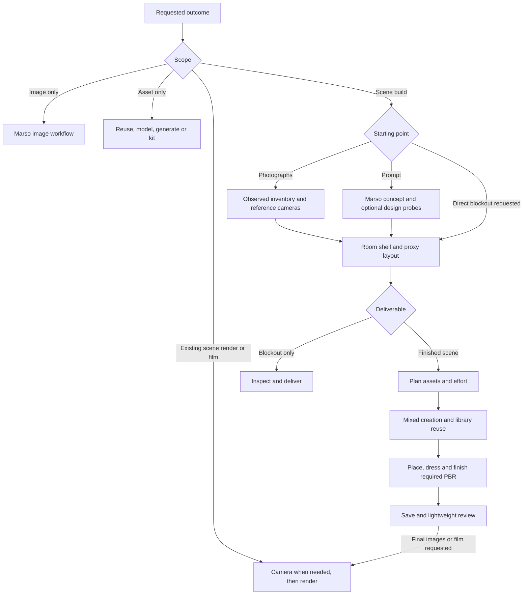

# Scene, asset and rendering workflow plan

Status: implementation and staged validation, 2026-11-01. Baseline `efd258d`; inspected Blender add-on source `da92d7a`. The scene coordinator, blockout and camera skills, direct design adapter, prompt-length helper and lighting guidance are implemented. See [compatibility](compatibility.md) for executed tests and remaining limits. The acceptance matrix below includes future qualification work; it is not a list of passed tests.

## Agreed behaviour

Primary objective: help users create convincing assets and scenes, with Marso as the normal material-finishing and reusable-library path. Good materials complement correct geometry, placement, lighting and camera work; they cannot repair failed construction. Search/reuse accepted library content where appropriate, finish new or changed appearances through the supported Marso Retexture/PBR route, then retain discoverable results for future work. Do not regenerate accepted PBR assets simply to demonstrate the platform, or add texturing to a geometry-only request.

- Full-scene blockouts are inspected by the agent, then work continues. Wait for user blockout approval only when requested; ask about a material ambiguity that cannot reasonably be resolved.
- Prompt-based scenes start with a Marso concept image unless the design is settled, the user requests a direct blockout, or image generation is unavailable/declined.
- Ordinary room corners default to 90 degrees in plan. Depart from that when the reference, a plan, measured data or the user's design supports it. Perspective slopes alone do not establish non-square walls.
- Keep explicit model-versus-generate intent. Infer reasonable effort from use, visibility, complexity and the requested outcome rather than repeatedly asking for polygon counts.
- Existing approval before Retexture/PBR of newly modelled geometry remains in force unless waived. Blockout continuation is not final asset approval.
- Keep preparation efficient: reusable construction helpers, native validation, targeted previews and checks proportional to the changed work. No new pricing/credit gates.

## Audit findings

| Priority | Current owner/evidence | Gap and proposed change |
| --- | --- | --- |
| High | `skills/core/marso/references/scene-workflow.md` | Text prompts skip image decomposition and go straight to a direct plan. Add concept generation and optional design probes, with an explicit direct-plan fallback. Move full-scene coordination into a discoverable standalone skill. |
| High | `skills/blender/marso-blender-place-scene/scripts/layout_plan.py` | Walls are projected separately from image floor lines/boxes, with push-back and guessed-wall fallbacks. There is no common orthogonal room constraint. Build a coherent shell before fitting and dressing it; do not make skewed corners compensate for a camera error. |
| High | `skills/core/marso-scene-graph/SKILL.md` and `scripts/plan_assets.py` | Planner expects a detected photographic graph. Add a direct design-plan input with stable design identities; do not counterfeit detections. Preserve the existing photographed-graph contract. |
| High | `skills/core/marso-scene-graph/references/route.md` and `scripts/plan_assets.py` | Category/size heuristics, including small versus large props, provide provisional routes. Add explicit functional and viewing requirements before accepting those suggestions. A small articulated mechanism must not be generated just because of size. |
| Medium | `skills/blender/marso-blender-asset/references/construction.md` | Good form/construction checks already exist. Add a compact effort contract and stop conditions; avoid duplicating its modelling instructions in a new skill. |
| High | `skills/blender/marso-blender-render/SKILL.md` and `agents/openai.yaml` | Discovery and body mostly emphasize performance. Expand discovery and guidance for lighting, realistic stills, colour management and compositing. Keep performance references conditional. |
| High | Existing scene review and render instructions | No dedicated owner for reusable camera paths, handheld motion, focus continuity and motion-blur preview. Add a camera skill usable on existing scenes without restarting scene creation. |
| Medium | `skills/core/marso-image/SKILL.md` | Image roles cover asset/appearance work but not coherent scene concept exploration. Add source provenance, anchor views, crop versus invented close-up, and reconciliation with the 3D shell. |
| High | `tests/routing/README.md` and `cases.json` | Existing routing evaluation covers mixed scenes and preparation, but not the new concept/blockout/camera paths. Add fresh-agent routing evaluations and Blender execution fixtures; distinguish proposed tests from passed ones. |

## Proposed skill boundaries

Only add real, tested skill folders when their implementation is ready. Do not publish placeholder SKILL.md files that an installer would advertise as working workflows.

| Skill | Change | Entry intent and ownership | Does not own |
| --- | --- | --- | --- |
| `marso` | Update | Broad intent routing, connection and explicit user constraints | Detailed scene orchestration after handoff |
| `marso-scene` | New, core | Complete scene from photos, a prompt or an existing scene; stage ownership, scope, review policy, resume and final completeness | Reimplementing image generation, modelling, placement or rendering |
| `marso-image` | Extend | Concept images, source-linked close-ups and proposed alternate views in the relevant Studio project | Claiming generated views measure hidden architecture; automatically starting 3D work for image-only requests |
| `marso-scene-decompose` | Retain, clarify | Standalone image inventory or inventory stage within a full build; distinguish photographs from generated concept views | Treating all apparent cross-view matches as certain identities |
| `marso-scene-graph` | Extend, retain name | Asset plan from photographic graph or explicit design plan; routes, unique masters, instances, effort and scene resource targets | Generation or implicit approval of the plan |
| `marso-blender-blockout` | New | Standalone graybox, metric room shell, dominant masses, openings, reference camera fit and early navigation clearance | Detailed furniture, finished materials or declaring placeholders complete assets |
| `marso-blender-asset`, `marso-blender-kit` | Extend narrowly | Model or kit construction at the agreed effort; preserve UV-ready construction parameters | Lighting polish used to disguise poor shape |
| `marso-blender-scene-assets`, `marso-library`, `marso-blender-texture` | Retain, adapt handoffs | Existing mixed generation/reuse/appearance routes and completion records | Overriding explicit creation choices or creating redundant PBR jobs |
| `marso-blender-place-scene` | Extend | Final placement/dressing, support/contact and instance hierarchy within the established shell | Recreating independently guessed walls after shell acceptance |
| `marso-blender-camera` | New | Still composition when needed; camera match, shot planning, paths, focus, handheld motion and shutter intent | Character animation, scene regeneration or image-model camera movement presented as real 3D footage |
| `marso-blender-render` | Extend | Lighting, still/sequence rendering, restrained compositing, performance and output validation | Automatic asset generation or unsolicited render campaigns |

Keep lighting and compositing as conditional references inside the render skill initially. Keep scene concept guidance inside the image skill. Split further only when a separately discoverable user workflow justifies it. Required helpers remain inside their owning leaf skill; discover companions by name rather than assuming sibling installation paths.

Proposed resources, introduced with implementation:

```text
skills/core/marso-scene/
  SKILL.md
  references/photo-reconstruction.md
  references/prompt-scene.md
  references/handoffs.md
skills/blender/marso-blender-blockout/
  SKILL.md
  references/room-and-camera.md
  scripts/room_shell.py
skills/blender/marso-blender-camera/
  SKILL.md
  references/shots-and-focus.md
  references/handheld.md
  scripts/camera_rig.py
skills/blender/marso-blender-render/references/
  lighting.md
  compositing.md
  performance.md                 # existing
skills/core/marso-image/references/
  scene-concepts.md
```

## Route selection

Apply priorities in this order: explicit scope/route and existing selection; source state and requested deliverable; functional constraints; visibility/quality; efficiency. If a combination is infeasible, explain the conflict rather than silently substituting. Named specialist requests can enter directly; they need not traverse every stage.

| User request | First owner | Path and stopping point |
| --- | --- | --- |
| Rebuild this room from photographs | `marso-scene` | Inspect photos → inventory + shell/blockout → asset plan → mixed creation/reuse → placement → required textures/PBR → lightweight review and saved scene |
| Build a room from a prompt | `marso-scene` | Brief → Marso concept → bounded design probes when useful → reconciled blockout → asset plan → same build/finish path |
| Make a quick room blockout | `marso-blender-blockout` | Shell and proxy masses → agent inspection → deliver blockout; no obligatory concept, generation, textures or final rendering |
| Only identify objects in these images | `marso-scene-decompose` | Inventory/graph/viewer; stop before building |
| Make a concept and closer view of the counter | `marso-image` | Source-linked image work and visual review; no unsolicited Blender build |
| Model this asset in Blender | `marso-blender-asset` | References → effort/functional brief → construction → model review → requested texture/PBR only |
| Generate an asset | `marso` → supported generation | Preferred compatible generator/options → reference/mesh review → requested finish; no silent hand modelling |
| Fill shelves with repeated packaging styles | Scene planner + texture appearance-family workflow | Resolve shape families → one master each → accepted style variants → repeated instances |
| Build a pack of different silhouettes or weapons | Asset/kit planning | Separate shape designs; do not turn shape diversity into texture variants |
| Make this existing scene look realistic | `marso-blender-render` | Preserve accepted assets → composition if needed → lighting/material diagnosis → small comparison → requested stills |
| Make a handheld walkthrough of this scene | `marso-blender-camera` → render | Path/focus/clearance → cheap motion preview → justified blur and lighting continuity → requested sequence |
| Reduce render time without changing the look | `marso-blender-render` | Performance branch only; preserve camera and art direction |



## Photograph reconstruction and blockout

Use a shared floor plane and room coordinate frame. Adjacent ordinary walls are perpendicular in plan, with common corner vertices; the whole room may rotate relative to the camera. Do not require every architectural element to be world-axis aligned. Bay windows, angled wings, sloped ceilings, irregular buildings and explicitly designed non-square rooms need supported exceptions.

Fit camera height, focal length/field of view, pose and scale anchors before moving walls to explain image slopes. Keep estimates and measurements distinct. A single image may be underdetermined; use other real views or stated dimensions where available and keep remaining assumptions explicit. A generated reverse view cannot overrule measured or observed architecture.

The blockout owns the shell, openings, major masses and stable entity ids. The placement workflow must consume those anchors and replace proxies under their owning entity roots, preserving user corrections. Use entity Empties with separate geometry groups; never parent independent supported objects beneath a mesh whose scale is edited.

Inspect a plan view and useful reference camera view. Check corner constraints, scale plausibility, doors/access, supports and major occlusion. Continue after the agent's check unless the user requested sign-off or important ambiguity remains. Do not demand user approval for every proxy. Blockout-only requests end here, with no implication that their placeholder assets are finished.

## Prompt scenes and image exploration

Create/select the relevant Marso Studio project before generating. Establish the spatial brief: room use, dimensions/scale assumptions, essential objects, mood/time, intended viewpoints and deliverable. Generate one useful anchor concept first; do not explore many unrelated concepts by default.

Distinguish three operations:

1. A crop of an existing image preserves its observed content but adds no new detail.
2. An image-edit close-up can propose detail beyond the source resolution. Mark that detail as generated.
3. A changed-view image can propose unseen areas but does not recover a measured camera or guarantee consistent geometry.

Request probes only to resolve a named design question, usually one or two at a time. Branch from the accepted anchor rather than repeatedly editing a drifting result. An explicitly accepted design revision can become a new anchor. Keep source/node ids, returned dimensions, image role and accepted/rejected status.

Check doors, windows, major furniture identities, counts, supports and material landmarks across images. Treat duplicates, disappearing openings and impossible adjacencies as conflicts; reconcile the design before creating all assets. Generated views remain proposals until accepted into the scene plan. For stronger spatial consistency, render the accepted Blender blockout from the intended camera and, where supported, use it with the concept as an image-edit reference. Such an image is still a design visualization, not a verified render of completed assets.

A local concept image is not automatically an authorized Retexture reference. Keep the existing default of detailed text briefs unless image-guided texturing was requested. Do not send a complete room image into a single-object mesh generator.

## Image prompt structure and limits

Make prompt construction an explicit implementation task in the image skill, with a shorter stage-specific handoff in the texture skill. A shared appearance brief carries accepted material roles, palette, condition and reference identities; each operation receives only the relevant subset. Do not paste the whole scene plan into each prompt.

Use this flexible order, omitting irrelevant fields:

1. **Outcome and subject:** what the image should depict or what this edit changes.
2. **Source roles and essential invariants:** which reference supplies layout, shape or appearance, and what must remain stable for this operation.
3. **Visible structure and material regions:** concrete features, proportions and distinct finishes; describe regions individually when they differ.
4. **Realism cues:** physically plausible surface response and a few observable details at the intended image scale. Include wear only where condition and use justify it.
5. **View and lighting:** framing, perspective and motivated illumination appropriate to the image's job, only when the endpoint supports those directions.
6. **Critical exclusions:** a small number of likely failure modes, not a generic negative-prompt wall.

This order is a practical authoring convention to test, not a claim that every model weights prompt positions identically. Descriptive precision matters more than length or adjective count. Replace vague repetitions of "photorealistic" with the actual surface cues that should be visible. Clean, maintained and new objects can be realistic without dirt, scratches or artificial grain.

| Operation | Emphasis | Keep out |
| --- | --- | --- |
| Scene concept | Spatial zones, major landmarks, activity, material palette, plausible light sources and camera intent | Full asset inventory, exact hidden measurements or promises of reconstructable geometry |
| Detail close-up | Named region, unchanged design/material identity, specific detail to reveal | Unrelated redesign or claims that generated detail was observed in the source |
| Proposed alternate view | Accepted anchors, requested viewpoint and plausible treatment of unknown areas | Claims of calibrated camera movement or guaranteed cross-view consistency |
| Asset generation reference | Isolated complete shape, proportions, construction, material roles and readable surfaces | Neighbouring objects, dramatic occlusion or scene dressing that could become fused geometry |
| Existing-mesh appearance edit | Shape/region source role plus rich surface appearance and restrained condition cues | Copying the guide's crude clay look; unsupported pixel/geometry locks |
| Retexture | Concise region-specific colour, material, finish, detail and condition | UV preservation, polygon counts, export checks, camera paths or grid bookkeeping |

Character-limit handling must be operation-specific. Read the active schema and any documented downstream limit; a bridge's accepted string length is not proof of the service/model's limit. The inspected bridge exposes different prompt ceilings for different commands. Do not publish one universal maximum or rely on a limit from another operation.

Count the final submitted string after reference substitution and optional enhancement text where those contribute to the endpoint limit. Keep room for additions the tool performs. Use the endpoint's documented counting convention; do not confuse characters, UTF-8 bytes and tokens. If the bridge expands prompts internally, its own preflight should validate the expanded payload and return a useful error without silently truncating it. Verify that behaviour before relying on it.

When over budget, remove repeated quality adjectives, duplicated context and optional details first. Compress phrasing while retaining subject identity, requested edit, source roles, essential constraints and distinguishing material cues. Never cut the string at an arbitrary character boundary. If essential scope cannot fit, simplify or split by a genuine operation/asset boundary rather than dropping requirements invisibly. Preserve the full appearance brief locally; send the shortest sufficient stage-specific prompt, not text padded to the maximum.

Illustrative Retexture brief for an approved wooden/metal chair:

> Walnut frame with a maintained satin finish, fine open pores and subtle variation between members; slight rubbing only at armrest edges. Charcoal woven upholstery with visible yarn variation and gently compressed fabric at seams. Blackened steel fasteners with restrained polished contact edges. Keep each existing material region distinct.

This is a proposed test prompt, not a verified service result. Its value should be judged on the actual returned material, including changed-light views, rather than whether the wording sounds elaborate.

Prompt evaluations should hold the source, model and supported settings constant, record uncontrollable variation, and compare source-role compliance, regional detail, believable finish, shape drift and transfer to PBR. Include short-limit fixtures, expanded reference labels, conflicting instructions, clean materials, worn materials and more than one material region. Passing a length check does not establish image quality. Pilot representative image → Retexture → PBR chains before expanding variants.

## Asset route and effort

Use one compact effort record, extending the existing asset plan instead of adding a competing manifest: explicit route/source, role, closest intended view, functional requirements, fidelity target, reason, and relevant scene limits. Retain user preferences separately from an agent's current decision.

| Need | Default direction |
| --- | --- |
| Exact selected scene/library asset | Resolve/reuse it; search is unnecessary when the source is already chosen |
| Exact dimensions, modular joins, moving parts, clean editable construction | Model, or hybrid with modelled functional parts |
| Organic complexity or distinctive decorative shape without exact topology needs | Generate/reuse, subject to explicit user intent and output inspection |
| Repeated identical objects | One accepted geometry/material master, instanced |
| Same shape with distinct packaging/finishes | One master per shape family, then independent texture variants |
| Deformation/animation requirements | Require suitable topology and a movement test; neither generation nor scripting guarantees readiness |

Provisional effort levels are blockout, scene-ready and hero/close-up. They express acceptance, not fixed polygon counts or promises about generation time. A scene-ready background prop needs convincing silhouette, proportions, supports and visible material response; a hero adds the construction/detail visible in the intended close-up. Keep reusable assets suitable for their agreed future use, not just the current camera.

Infer routine decisions and state them briefly. Ask only when constraints conflict materially, such as an extremely short deadline plus an exact articulated hero asset. Establish resource targets once for a multi-object scene. Allocate effort to the difficult/visible objects, test a representative construction family, then reuse it. Additional subdivision or detailed textures cannot compensate for a failed shape check.

Separate active authoring/preparation time, cloud queue/processing time and rendering time. Bound exploratory alternatives, repair the failing stage and stop when the agreed visual/function criteria are met. Do not market known-recipe replay times as fresh-agent completion times.

## Lighting, cameras and compositing

Render guidance should start from intent: neutral inspection, realistic presentation or deliberately stylized work. For realistic scenes, use plausible source direction/size, practical lights, sky/window contribution and restrained supporting light. Inspect contact, reflection shape, shadow detail and focal separation before increasing samples or adding effects. Keep raw Marso maps unchanged; diagnose material, geometry and lighting problems separately.

Camera work owns viewpoint, sensor/lens framing, focus target, shot duration and path. Do not choose a wide lens solely to fit a poorly planned room or use extreme depth of field to hide construction errors. Still-image composition should work without loading animation instructions.

For motion, choose a physical camera behaviour: tripod, dolly, orbit, handheld standing or handheld walking. Plan clearance and framing throughout the move, including the near plane and interpolated path between keys. Handheld movement should follow travel speed, turns and pauses with restrained sway and recoveries, rather than arbitrary high-frequency shake. Preserve explicit smooth/stabilized requests. Shutter and frame rate determine blur intent; inspect an actual motion segment rather than judging blur from a single still.

Lighting/render references own exposure, colour management, restrained highlight bloom/glare, optional lens effects and output handling. Bloom is not a substitute for lighting or a cure for washed-out materials. Preserve a clean comparison and saved compositor settings. Check temporal stability, focus changes, blur, clipping and denoising across a short segment before rendering the full sequence. Effects and atmosphere are optional and scene-dependent; clean realism does not require dirt, haze or grain.

Use a small preview set, escalating quality only after framing and lighting work. For an ordinary still, do not require a full lighting analysis campaign. For animation, framing samples alone do not certify collision-free motion; combine path checks with a low-cost moving preview. Resume only outputs whose scene/shot/settings revision matches, so stale frames cannot silently mix with a new render.

## Capability work and handoff contracts

### Marso finishing and reusable-library completion

The normal finished-asset path is library reuse when suitable, or model/generate → approved geometry where required → Marso appearance/PBR → visual review → verified library result. Retexture continues directly to PBR through the supported chain. Existing satisfactory PBR assets keep their maps; apply local supported treatments such as glass when Marso does not generate that property.

Keep a reusable master independent of its scene placement. Record project, source/result identifiers, descriptive asset/style/material labels, dimensions, intended use and available variant relationships using supported fields or the local manifest. Verify completion, mint status and library discoverability separately when required by the route; an accepted job or local Blender file is not evidence that a searchable library result is ready. Resume/follow the existing job instead of resubmitting to make it appear sooner.

Demonstrate the library benefit in acceptance tests: finish a new asset, find it again through the supported library route, and reuse it in a second scene without duplicate generation. Inspect import scale, materials, hierarchy and shared instances. Search for an appropriate existing source before creating a replacement when the user has not explicitly requested a new design. A selected source ID should resolve directly, without a redundant broad search.

### Further placement and rendering work

Extend the existing support graph with only the relationships needed by the current scene: containment, facing/alignment, wall attachment, proximity, support contact and access clearance. Distinguish hard geometric requirements from soft composition preferences. First identify candidate placements cheaply; run exact contact/collision checks on the affected neighbourhood when needed. Changing one object should not trigger a full-scene validation or random repositioning of accepted assets. Report incompatible constraints rather than silently breaking scale or the room shell.

Keep a lighting baseline for a scene/sequence, with named source roles and consistent direction, colour and exposure intent. Use matched views/contact sheets to inspect continuity. Where repeated balance changes justify the setup, evaluate Cycles light groups and saved linear passes to adjust contributions without repeating full renders. This can rebalance existing light contributions; it cannot reproduce moving a light or changing geometry. Do not require multilayer output or extra pass analysis for every simple review still.

Separate research evidence from release evidence: these are methods to adapt and test, not imported implementations or performance guarantees. Benchmark placement corrections, prompt authoring/preflight, service queue time and rendering separately. Assess realism at the intended viewing distance and preserve the user's quality target throughout.

### Bridge integration

Source inspection found `generate_image`, reference-conditioned `scene_reference`, project selection and job tracking in the add-on. Both image commands currently select object mode, so neither establishes full-room scene generation support. `scene_reference` creates an image-generation node from one reference; it is not evidence of a generic dedicated image-edit command, calibrated camera control, multiple-reference support or locked image dimensions. Those capabilities must be inspected and tested before promising the concept-probe route through the add-on alone.

If the public bridge lacks required image-edit controls, propose an add-on extension with an explicit source/reference contract, supported aspect/resolution choices, relevant project, job identity, result dimensions and non-destructive branching. Name no speculative command as available. For Blender work, inspect and use the add-on first. Do not silently switch to a separate hosted MCP. Another verified connection applies only when already part of the user's chosen workflow. Continue supported local stages and report missing operations; never import private implementation functions as a workaround.

Room constraints, camera rigs and render/compositor controls can use verified Blender control without a cloud add-on change. They still need Blender-version execution tests. No backend change is assumed for the planning, layout or rendering additions.

Keep one scene-run record, reusing existing graph/plan/import/placement files. Extend it only with missing information: input provenance, source views, shell revision, effort choices, review policy, accepted asset/source revisions and shot/output revision. A stage handoff must name its owner, artifact, assumptions, unresolved items and completion status. Plans, approvals and executed outcomes remain distinct. Avoid a new orchestration framework or an additional per-stage questionnaire.

## Implementation sequence and acceptance

| Phase | Work | Release evidence |
| --- | --- | --- |
| 1: Routing and scene contract | Develop `marso-scene`; adjust root discovery; consolidate scene-stage ownership; extend image/asset planning; encode agreed blockout policy | Fresh-agent routing evaluations on photos, prompts, direct blockouts, image-only work, explicit creation routes and existing scenes; no unintended cloud/render work |
| 2: Blockout and placement | Shared room-shell constraints; camera fit assumptions; direct design-plan input; preserve accepted anchors/user corrections | Blender fixtures: oblique photo of a square corner, documented non-square exception, multi-view conflict, proxy replacement and deterministic resume |
| 3: Lighting and stills | Expand render metadata and conditional lighting/compositing guidance; minimal reusable setup/comparison helpers | Matched-camera before/after renders on accepted assets and a furnished interior, inspected for realism and measured elapsed time; raw PBR unchanged |
| 4: Cameras and motion | Develop camera skill and rig helper; path/focus/handheld/shutter; non-destructive output/resume | Short dolly and handheld sequences, stop/start behaviour, focus and clearance checks, real blur test, frame completeness and stale-revision rejection |
| 5: Complete workflow | Connect verified Marso concept/probes to blockout and mixed creation; update examples/install discovery | Live prompt-to-scene trial and photograph-to-scene trial, with both agent-led continuation and explicit review gates; publish supported limits |

Do not release phase 5's capability claims before the image-edit bridge question is resolved. Each developed skill must pass isolated-package/local-link checks and work when optional companions are absent. Future blind tests should start from installed metadata, without development history or the grading rubric. Tool simulations are routing evidence only, not live Blender or Marso evidence.

## Required routing evaluation cases

These are acceptance targets. Consult the dated compatibility record for the subset actually executed:

| Input | Expected decision | Failure to catch |
| --- | --- | --- |
| Rebuild an oblique room photo; no unusual architecture | Photo reconstruction with a right-angle shell prior and camera fit | Skewing walls to match image slopes |
| Rebuild a documented 120-degree bay | Preserve supported exception | Forcing all walls to 90 degrees |
| Make a kitchen blockout only | Direct local blockout, inspect and deliver | Starting concept generation, mesh jobs or PBR |
| Build a workshop from a text prompt | Relevant project → concept → useful probes → reconciled blockout → mixed routes | Directly generating a whole room mesh or stopping at the concept |
| Same prompt, but use my settled floor plan | Respect plan; omit unnecessary concept exploration | Replacing authoritative dimensions with generated images |
| A generated reverse view invents a second doorway | Record/reject conflict against accepted shell | Treating it as newly discovered photographic evidence |
| Inspect blockout and carry on | Agent review, continue independent work | Unrequested blockout approval pause or treating it as model-texture approval |
| Show me the blockout before continuing | Save/show and wait at requested stage | Executing downstream work prematurely |
| Model a small articulated kettle | Explicit modelling and functional topology requirements | Size heuristic silently choosing generation |
| A hero close-up and 40 background copies | Allocate effort by role and instance approved masters | 41 independent generations or uniformly expensive detail |
| Light my existing scene realistically | Render branch, preserve geometry/material source | Restarting asset creation or forcing cinematic effects |
| Add a smooth walkthrough | Camera path and motion preview without handheld noise | Adding shake because realism was requested |
| Handheld walkthrough that pauses at a display | Travel-aware motion, stable focus and short blur preview | Continued walking bob while stationary or camera crossing a wall |
| Only reduce render time | Performance branch, matched quality comparison | Re-lighting, changing composition or degrading agreed quality |
| Resume after changing a shot's lens | Invalidate affected output revision | Combining stale and new frames |
| Prompt fits locally but reference expansion exceeds the endpoint limit | Validate final payload; compress nonessential wording while retaining source roles and material distinctions | Silent truncation or a repeated rejected submission |
| Finish a master, then reuse it in another scene | Verify supported library availability and resolve the existing result | Duplicate generation or claiming library completion from a local save |
| Required companion or image-edit tool absent | Capability check and bounded fallback/clear gap | Inventing tool names, sibling paths or an execution result |

The aim is reliable discovery and observable handoffs. Natural-language routing cannot be guaranteed by a README or structural tests alone; failed routing cases must revise the smallest owning instruction and rerun with adjacent cases to detect overcorrection.
