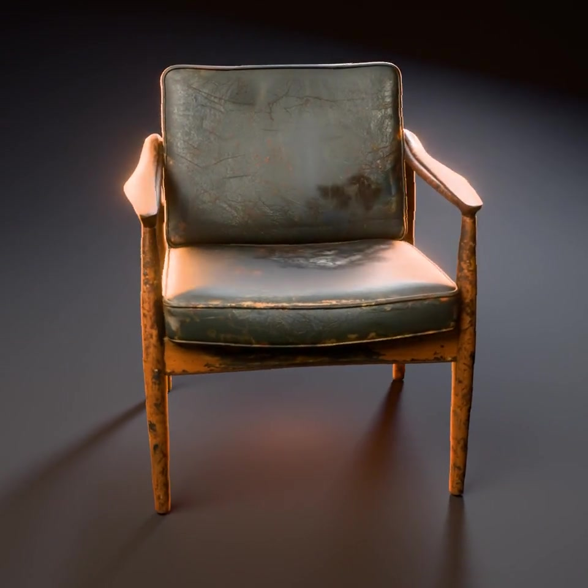
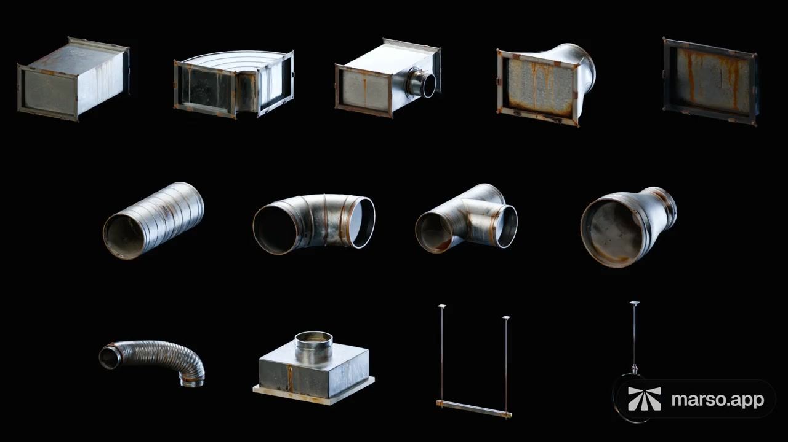
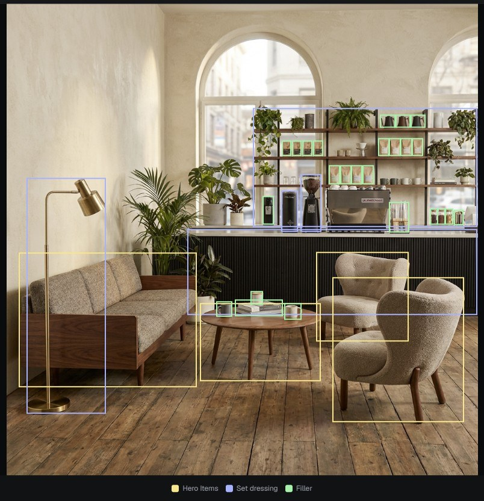

# Learn Marso by making something

[Back to Marso Skills](../README.md) · [Set up Blender](blender-setup.md) · [What PBR and USD give you](pbr-and-usd.md)

Start with one object and one finish. You can ask the agent to explain its choices as it works; you do not need to know the names of the skills or every Blender operation.

## Start here: generate your first asset

> Help me make a weathered ceramic plant pot with Marso. Explain image generation, 3D generation and PBR as we go. Show me the image before making the mesh. Save it to a project called Garden Props, and show me the finished asset and its library entry.

The route is **Generate image → Generate 3D → Generate PBR → minted USD and library**. A reference image can replace image generation. Ask for a different shape at the image/model stage; ask for a different finish at the texturing stage. The agent should distinguish a completed PBR run from completed USD minting.

You learn how a visual reference becomes geometry, how PBR changes its response to light, and where the result lives. Finish by finding the asset again from a new request.

## Learn modelling with an agent

> Teach me while we model a small wooden side table in Blender. Explain the proportions and construction, then show me a clay preview. After I approve it, prepare the UVs and use Marso to give it worn oak and blackened steel fittings. Save the Blender file and identify the Marso result.

Modelling is useful when dimensions, editable topology, separate moving parts or precise connections matter. Review silhouette and construction before texturing. Good textures cannot repair a wrong shape.

Useful follow-ups:

- “Explain why you placed those UV seams, and show me the packed layout.”
- “What can I change safely without affecting the other objects?”
- “Show the material in neutral lighting and in a different environment.”
- “Find this asset in my library so I can reuse it in another scene.”

## One source, several finishes

> Make three versions of this chair: new black leather, gently worn brown leather and faded blue fabric. Create each from the original source, keep its geometry and UVs unchanged, then add PBR. Show them side by side under the same lighting.

Each appearance branches from one preserved baseline. That prevents wear and detail from accumulating accidentally as one generated output becomes the next input. Inspect each finished material, then use linked geometry where the final copies truly share the same shape.

**Mesh reuse saves geometry memory.** Different appearances still need their texture sets and material evaluation. A material change can also affect batching or draw calls in a game engine. Plan the number and resolution of looks at scene scale.

## Appearance changes over time

> Give this metal bucket clean and rusty states using Marso Retexture and PBR from the same original mesh. In Blender, make a Rust Amount control from 0 to 1, with an optional painted mask, and show the endpoints and halfway point. Keep the geometry unchanged.

This is a material-state workflow: clean → dirty, painted → weathered, intact surface → scorched finish. A state parameter can be animated or driven by your own time, exposure or gameplay logic. A spatial mask lets the change happen in selected regions.

[Watch the appearance-state example →](assets/demos/appearance-states.mp4?raw=true) This demonstrates appearance change; combustion, smoke, deformation and broken geometry are separate effects.

Generate and inspect the PBR states before building the transition. Use aligned UVs and consistent map roles. Blender shader controls do not automatically become interactive controls in a game engine or a minted USD; export the maps and recreate or bake the required material behaviour for the target.

Choose how the states relate. For independent finishes, create each from the original. For accumulating damage, explicitly request **clean → worn → heavily weathered**, using each edited state as the next source. Each state still gets its own PBR result: clean → PBR, worn → PBR, weathered → PBR. The agent preserves that lineage and checks that the geometry and UVs still correspond before blending.

## Stock a scene without rebuilding every object

> Stock this fridge from the reference. Group products by shape, model one master for each can or bottle shape, and use Marso to create distinct label designs and PBR finishes. Reuse the same mesh for copies of a shape, and preserve clear glass separately.

Separate **shape families** from **appearance families**. A short can and a tall can need different masters. Twelve identical chairs need instances, not twelve Retexture jobs. Twelve different labels can share a can master with different material sets. Different weapon or shield silhouettes are a geometry pack, not a texture-variation task.

For many variants, the agent can prepare a labelled image grid, author looks through Marso image editing and split the results back into references. Check a representative final Retexture/PBR result before expanding the method. A convincing image is only the first half of that pipeline.

## Build a modular kit, then use it

> Build a modular ventilation kit in Blender: straight duct, elbow, junction and vent. Agree dimensions and connectors first. Show the modelled parts, then texture them with Marso as used galvanised steel. Assemble two layouts from the same masters.

[Watch the modular kit example →](assets/demos/modular-ducts.mp4?raw=true)

The agent plans join positions, dimensions and repeated interfaces before modelling. Seams can sit under flanges, trim or other natural boundaries. Reusable parts keep surfaces that may become visible in another arrangement. Textured masters can then form multiple layouts and return through the library for future work.

For articulation, ask for separate parts and deliberate pivots: “Keep the lid and handle independently movable.” A part hierarchy is a foundation for rigging or physics, not a substitute for a tested mechanism.

## Rebuild a reference scene in Blender

> Use these room photos to build a Blender scene. First use the scene skills to identify objects across views and show me the scene graph. Search my Marso library before making missing props. Propose which objects to model, generate, instance or build as a kit, then finish the visible assets with Marso and show review images.

The default route is the agent using the **scene decomposition and scene-graph skills**, followed by Blender construction and placement. It does not require a Marso Detect Objects node. The built-in detection tool is an optional source of observations when useful or explicitly requested.

The graph tracks identity, count and support relationships: the same chair in two photos should not become two unique assets. The plan records creation choices and a scene-wide geometry/texture budget. Blender uses Empty-based entity groups so resizing a table's mesh does not resize everything supported by that table.

The result is an editable reconstruction you can improve, rearrange and restyle. Ask for specific changes—layout, material condition, furniture replacement or lighting—instead of expecting one automatic photo-to-scene operation to resolve every ambiguity. Finish with a saved scene and lightweight review images; request a final render when you want one.

Optional: Marso's built-in Detect Objects

The Studio tool can supply object regions when it is useful or requested. The scene skills add cross-view identity, relationships, creation choices and placement planning. Neither a collection of boxes nor a successful detection run is a finished Blender scene.

## What to review

Check the shape before the material; check material response under changing light; check scale and contacts in the assembled scene. Keep useful originals and record the library result. If something is wrong, tell the agent which stage failed rather than simply asking it to “make it better.”

> The silhouette is right, but the brushed metal looks painted. Keep the geometry and UVs. Diagnose the material under neutral lighting before generating again.
